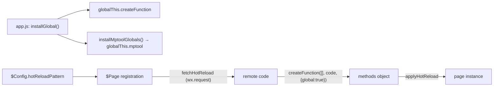

# AGENTS.md

Guidance for AI coding agents working in this repository. `CLAUDE.md` only imports this file, so keep this file as the single source of truth.

## Project Overview

**mptool** is a lightweight mini-program (WeChat) enhancement framework. It provides enhanced app / page / component wrappers and extra lifecycles, a cross-component emitter, file / network / parsing / encoding utilities, and `@mptool/run`, a self-built JavaScript interpreter that replaces the disabled `eval` / `new Function` in mini-program runtimes (it powers server-driven page hot reload).

- Repository: [miniapp-tool/mptool](https://github.com/miniapp-tool/mptool) · License: MIT · Author: Mr.Hope
- Monorepo: pnpm workspace (`packages/*`, `demo/`, `docs/`), **12 packages** in `packages/`, all published to npm
- Build: tsdown — every package emits a single ESM file (`dist/index.js`) plus `dist/index.d.ts`
- Test: vitest with istanbul coverage; type tests use `*.spec-d.ts`
- Lint / format: oxlint + oxfmt (both configured through `oxc-config-hope` presets)
- Docs: VuePress 2 site in `docs/`
- Versioning / publishing: lerna-lite, driven by `.github/workflows/publish.yml`
- Required toolchain (from `package.json` → `devEngines`): the Node and pnpm versions declared there. CI uses the same Node range through `pnpm/setup`'s `runtime` input.
- Exact dependency versions (vitest, TypeScript, tsdown, oxlint, …) live in `package.json` / `pnpm-lock.yaml`. **Do not copy version numbers into docs** — point at `package.json` instead.

## Setup & Commands

Install with `pnpm install` (the root `postinstall` script runs `husky` to install git hooks).

The table lists **every** script defined in the root `package.json`; the "Implementation" column quotes the script verbatim.

| Script                     | Implementation                                                                              | Purpose                                                                                                                                                                 |
| -------------------------- | ------------------------------------------------------------------------------------------- | ----------------------------------------------------------------------------------------------------------------------------------------------------------------------- |
| `pnpm run build`           | `unrun scripts/sync-enhance.ts && cross-env NODE_ENV=production pnpm --stream -r run build` | Regenerate the shared `enhance` → `skyline-enhance` files, then build all packages (production: minify + publint) and type-check `demo/` through its `build` script     |
| `pnpm run dev`             | `unrun scripts/sync-enhance.ts && cross-env NODE_ENV=production pnpm --stream -r run dev`   | Same sync, then recursive `dev`. **No package defines a `dev` script** (only `build` / `clean`), so this currently builds nothing — use `build`                         |
| `pnpm run clean`           | `pnpm --stream -r run clean`                                                                | Remove every package's `dist/` (`rimraf ./dist`)                                                                                                                        |
| `pnpm run copy`            | `unrun scripts/copy-package.ts`                                                             | Copy `packages/all/dist` + `package.json` into `demo/node_modules/@mptool/all` for the demo                                                                             |
| `pnpm run test`            | `vitest run --coverage`                                                                     | Full test suite with coverage (see [Testing](#testing))                                                                                                                 |
| `pnpm run typecheck`       | `tsc -p tsconfig.json --noEmit`                                                             | Type-check all sources, tests and type tests (run after `build`, like tests)                                                                                            |
| `pnpm run lint`            | `oxlint --fix && oxfmt`                                                                     | Lint + format with auto-fix                                                                                                                                             |
| `pnpm run lint:check`      | `oxlint && oxfmt --check`                                                                   | Read-only lint/format check (CI gate)                                                                                                                                   |
| `pnpm run changelog`       | `conventional-changelog -p angular -i CHANGELOG.md -s -r 2`                                 | Append the last 2 releases to the root `CHANGELOG.md`                                                                                                                   |
| `pnpm run docs:build`      | `pnpm --dir=docs run docs:build`                                                            | VuePress production build (`vuepress build .`)                                                                                                                          |
| `pnpm run docs:check`      | `tsc -p docs/tsconfig.json --noEmit`                                                        | Type-check the VuePress docs project (`docs/tsconfig.json`, extends `@mr-hope/tsconfig/web.json`)                                                                       |
| `pnpm run docs:dev`        | `pnpm --dir=docs run docs:dev`                                                              | VuePress dev server                                                                                                                                                     |
| `pnpm run packages:update` | `pnpm dlx npm-check-updates -u --workspaces`                                                | Interactive dependency upgrade (root `.ncurc.js` sets `workspaces: true`; npm-check-updates rejects `--deep` together with `--workspaces`, so do not add `--deep` back) |
| `pnpm run postinstall`     | `husky`                                                                                     | Install git hooks (runs automatically after install)                                                                                                                    |

There is **no `release` script**. Releases are cut by a maintainer through the `workflow_dispatch` workflow `.github/workflows/publish.yml` (lerna-lite `version` → `publish from-package` → `unrun scripts/sync.ts` to mirror to npmmirror).

Typical agent loop: edit sources → `pnpm run build` (needed before tests, see pitfalls) → `pnpm run lint:check` → `pnpm run typecheck` → `pnpm run test`.

## Repository Layout

```text
mptool/
├── packages/            # 12 packages, one directory per npm package
├── scripts/             # Repo tooling (run with `unrun`, TypeScript executed directly)
│   ├── sync-enhance.ts  # Copy the 12 shared enhance files into skyline-enhance (run by build/dev)
│   ├── copy-package.ts  # Copy @mptool/all dist into demo/node_modules
│   ├── copy.ts          # Recursive copy / mkdir helpers used by the scripts above
│   ├── tsdown.ts        # Shared tsdown config factory (es2018, single-file ESM, dts via oxc, atob injection, Codecov bundle analysis)
│   ├── atob.ts          # atob polyfill injected into bundles (htmlparser2's `entities` needs it)
│   └── sync.ts          # Mirror published packages to the npmmirror registry (release only)
├── demo/                # Demo mini-app (workspace dep on @mptool/all; `build` type-checks it, `demo:build` emits JS)
├── docs/                # VuePress site (guide / enhance / skyline-enhance / net / file / api / parser / run / mock)
├── .github/workflows/   # test.yml, docs-check.yml, docs.yml, publish.yml, codeql-analysis.yml, scraper.yml
├── vitest.config.ts     # Coverage (istanbul) + typecheck
├── tsconfig.json        # Extends @mr-hope/tsconfig/check.json, isolatedDeclarations
├── oxlint.config.ts / oxfmt.config.ts
├── lerna.json           # lerna-lite version/publish + changelog preset
├── pnpm-workspace.yaml  # Workspace: packages/*, demo/, docs/
└── .ncurc.js            # npm-check-updates options
```

Each package directory contains: `package.json` (`exports` → `dist/`, `files: ["dist"]`), `tsdown.config.mts` (built on `scripts/tsdown.ts`), `README.md`, `LICENSE`, `CHANGELOG.md`, `src/` (entry `src/index.ts`) and `__tests__/` (`*.spec.ts`; type tests `*.spec-d.ts` exist in `shared`, `net`, `enhance` and `skyline-enhance`).

Generated / ignored paths: `dist/`, `coverage/`, `docs/.vuepress/{cache,temp,dist}`, `demo/**/*.js` (compiled demo output), `node_modules/`. Do not edit or commit these.

## Architecture

### 1. Enhancement framework — `@mptool/enhance`

- **`$App`** — app wrapper. Adds the `onAwake` lifecycle (fired after the app returns to foreground, with the sleep duration) and instance methods `$on` / `$off` / `$emit` / `$emitAsync`.
- **`$Page`** — page wrapper. Adds `onRegister`, `onAppLaunch`, `onNavigate`, `onPreload`, `onAwake`; properties `$name`, `$state.firstOpen`, `$refs`; methods `$` (component binding), `$on` / `$off` / `$emit` / `$emitAsync`, `$go` / `$redirect` / `$switch` / `$reLaunch` / `$back`, `$preload`, `$currentPage`, `$getPath`.
- **`$Component`** — component wrapper: typed props, `$refs`-based parent/child references, `$call(method, ...args)` to call a method on the component instance.
- **`emitter`** — global event bus (`userEmitter`) for cross-component / page / app communication.
- **`$Config`** — global config: `home`, routes (`defaultPage` + `pages` map, or a custom `getPath`), navigation timing (`maxDelay` / `minInterval`), hooks (`extendPage` / `injectPage` / `extendComponent` / `injectComponent`), and `hotReloadPattern`.
- **Navigation** — `go` / `redirect` / `switchTab` / `reLaunch` triggers with a navigation lock (released after the target page `onReady` + `minInterval`); `navigator/` resolves names/URLs and awaits `onNavigate` hooks up to `maxDelay`.
- **`bridge.ts`** — mounts the framework methods on pages/components (`mount`), implements `$` binding, `$preload`, `$currentPage`, `$getPath`, and the `$bindGo` / `$bindRedirect` / `$bindSwitch` / `$bindRelaunch` / `$bindBack` click proxies.
- **`hotReload.ts`** — fetches, caches and applies page hot-reload method objects (see §3).

### 2. JS interpreter — `@mptool/run`

Mini-program runtimes disable `eval` / `new Function`, so `@mptool/run` implements a full `lexer.ts` → `parser.ts` (AST) → `interpreter.ts` pipeline (`environment.ts` holds the global/sandbox environment, `ast.ts` / `value.ts` the node and value models).

- `run(code, options?)` — run once; returns a `Promise` when the code contains async operations.
- `runSync(code, options?)` — run synchronously; throws when async is triggered.
- `createSandbox(options?)` — reusable sandbox sharing global state (`run` / `setGlobal` / `getGlobal`).
- `createFunction(args, body, options?)` — replacement for `new Function`; the returned function preserves the caller's `this`, so `fn.call(page)` exposes the page instance.
- `installGlobal()` — mounts `createFunction` on `globalThis.createFunction` for hot reload.
- `RunOptions`: `globals`, `global`, `maxSteps`, `maxStack`, `strict`, and feature toggles `features.class` / `forOf` / `async` / `bigint` (all enabled by default).
- **It is not a security sandbox** — built-ins reuse the host runtime, so only trusted / semi-trusted dynamic code is in scope. It targets WeChat only (minimum base library 3.8.2); QQ is explicitly unsupported.

### 3. Page hot reload (core pipeline)



- The host calls `installGlobal()` (from `@mptool/run`) in `app.js`, before any page registers. If hot-reload code needs `api` / `file` / `net` / `parser` helpers, it also calls `installMptoolGlobals()` (from `@mptool/all` or `@mptool/skyline`) to mount the `globalThis.mptool` namespace.
- With `$Config({ hotReloadPattern })` set (`$name` is replaced by the page name), `$Page` starts an async `wx.request` at registration. Only `statusCode === 200` responses with a non-empty string body are executed; the result must be an object, which is cached per page name.
- The method object is merged onto the page instance (`applyHotReload`); if the fetch has not resolved yet, the instance is registered and patched once it does. A method named `onHotReload` (exported as `HOT_RELOAD_ON_READY_KEY`) is auto-invoked — at `onReady` if the page is not ready yet, immediately otherwise.
- Hot reload is best-effort: it never blocks registration or loading, and every fetch / parse / execution failure is silent.

### 4. Bundles

- `@mptool/all` re-exports `api` + `enhance` + `file` + `net` + `parser` (imported from their `src/index.ts` at build time), selected `@mptool/shared` symbols, and `installMptoolGlobals` / `mptoolGlobals`.
- `@mptool/skyline` re-exports `net` + `skyline-enhance` + `file` + `parser` and `installMptoolGlobals` / `mptoolGlobals`.
- `@mptool/run` is deliberately **not** part of either bundle; hosts import it separately.

## Package Map

| Package                   | Responsibility                                                                                                                                                                                                                                                                                                                          |
| ------------------------- | --------------------------------------------------------------------------------------------------------------------------------------------------------------------------------------------------------------------------------------------------------------------------------------------------------------------------------------- |
| `@mptool/enhance`         | Enhancement framework: `$App` / `$Page` / `$Component`, extra lifecycles, emitter, lock-guarded navigation, page hot reload                                                                                                                                                                                                             |
| `@mptool/skyline-enhance` | Slim variant of `enhance` for WeChat Skyline (base library 3.0+): same wrappers / `$Config` / emitter / hot reload, but page lifecycles are limited to `onRegister` + `onAwake` (no `onAppLaunch` / `onNavigate` / `onPreload`, therefore no `$preload` instance method) and navigation has no lock (`getFullPath` + `getTrigger` only) |
| `@mptool/run`             | Self-built JS interpreter replacing `eval` / `new Function`; powers page hot reload                                                                                                                                                                                                                                                     |
| `@mptool/all`             | Single-file full bundle (api + enhance + file + net + parser + selected shared exports + `installMptoolGlobals`)                                                                                                                                                                                                                        |
| `@mptool/skyline`         | Single-file bundle for WeChat Skyline (base library 3.0+) (net + skyline-enhance + file + parser + `installMptoolGlobals`)                                                                                                                                                                                                              |
| `@mptool/api`             | wx API wrappers: clipboard, contact, permission (`withScope`), `compareVersion`, page info (`getCurrentPage` / `getCurrentRoute`), media (document / photo), network (download / report), UI (toast / modal / confirm / retry / window), update                                                                                         |
| `@mptool/file`            | File operations (`readFile` / `writeFile` / `readJSON` / `writeJSON` / `ls` / `mkdir` / `rm` / `unzip` / `saveFile` / `saveOnlineFile`) and expiring storage (`set` / `get` / `remove` / `check`, sync + async)                                                                                                                         |
| `@mptool/net`             | Networking: fetch-style `request` / `createRequest`, `Headers`, `URLSearchParams`, `Cookie` and `CookieStore`                                                                                                                                                                                                                           |
| `@mptool/parser`          | HTML → rich-text node parsing, plus `svg` / `text` helpers and an allowed-tag list                                                                                                                                                                                                                                                      |
| `@mptool/encoder`         | `TextEncoder` / `TextDecoder` polyfills for UTF-8, GBK and GB18030 (GB2312 is supported through the GBK labels). `TextEncoder` is UTF-8 by default and accepts a **non-standard** encoding label for the other supported encodings (e.g. `new TextEncoder("gbk")`; WHATWG's encoder is UTF-8 only)                                      |
| `@mptool/shared`          | Shared utilities: `Emitter`, `logger`, `query`, `env`, errors, `lock` / `once` / queues, base64 helpers                                                                                                                                                                                                                                 |
| `@mptool/mock`            | `wx` API mock for tests / dev; installs `globalThis.wx` plus `Page` / `App` / `Component` / `Behavior` / `getCurrentPages` mocks                                                                                                                                                                                                        |

## Inter-package Dependencies

All workspace packages are **inlined at build time** (`tsdown` `alwaysBundle: [/^@mptool\//]`, and `@mptool/parser` also bundles `htmlparser2` / `dom-serializer` / `domhandler`). Everything below is therefore a **devDependency**: published packages ship no `dependencies`, and consumers install nothing extra.

```text
@mptool/all             → api, enhance, file, net, parser, shared   (dev)
@mptool/api             → shared, mock                              (dev)
@mptool/enhance         → run, shared, mock                         (dev)
@mptool/file            → shared, mock                              (dev)
@mptool/net             → shared, mock, set-cookie-parser           (dev)
@mptool/parser          → htmlparser2, dom-serializer, domhandler, mock (dev)
@mptool/run             → mock                                      (dev)
@mptool/shared          → base64-arraybuffer, mock                  (dev)
@mptool/skyline         → file, net, parser, skyline-enhance        (dev)
@mptool/skyline-enhance → run, shared, mock                         (dev)
@mptool/encoder         → (none)
@mptool/mock            → miniprogram-api-typings                   (runtime dependency)
```

`miniprogram-api-typings` is an **optional peer dependency** (`^5.0.0` + `peerDependenciesMeta.optional`) of every package except `@mptool/encoder` and `@mptool/mock`: it only supplies the global mini-program types for `.d.ts`, so consumers do not need to install it. `@mptool/mock` depends on it directly.

## Conventions & Pitfalls

### enhance ↔ skyline-enhance dual-package sync (easiest to get wrong)

`skyline-enhance` is a slim copy of `enhance`. `scripts/sync-enhance.ts` copies exactly **12 files** from `packages/enhance/src/` to `packages/skyline-enhance/src/` before every `build` / `dev`:

`app/index.ts`, `app/typings.ts`, `component/index.ts`, `component/store.ts`, `config/index.ts`, `emitter/index.ts`, `emitter/typings.ts`, `hotReload.ts`, `navigator/index.ts`, `navigator/typings.ts`, `page/index.ts`, `index.ts`.

- Edit these files **in `enhance` only**; hand edits in `skyline-enhance` are overwritten by the next sync.
- Everything else is maintained per package, notably `config/typings.ts`, `page/page.ts`, `page/typings.ts`, `bridge.ts`, `constant.ts`, `app/app.ts`, `component/component.ts`, `component/typings.ts`, `config/config.ts`, `emitter/emitter.ts`, `navigator/navigator.ts`. When a change touches `$Page` / `$Config` / navigation, update both packages (the hot-reload integration had to touch both `page/page.ts` files).
- The hot-reload spec exists in both `packages/enhance/__tests__/hotReload.spec.ts` and `packages/skyline-enhance/__tests__/hotReload.spec.ts`; keep them in sync.

### Build before test

Tests import workspace packages by package name (e.g. `import "@mptool/mock"`, `import { createFunction } from "@mptool/run"`), which resolve through each package's `exports` field to `dist/`. Run `pnpm run build` before `pnpm run test` (CI does exactly this). After changing `@mptool/mock` source, rebuild it before running dependent packages' tests: `pnpm --filter @mptool/mock build`.

### Build output constraints

- Each package bundles to a single ESM file; workspace dependencies are inlined, so avoid circular package dependencies.
- The tsdown config targets **ES2018** on purpose (WeChat base library 3.8.2 ≈ iOS 14 / Chrome 86; `?.` / `??` fail to parse on upload). Do not raise `target` without checking the mini-program runtime.
- `scripts/atob.ts` is injected into bundles because `htmlparser2`'s `entities` uses a global `atob`, which mini-program environments lack. Keep this injection when adding bundling config.
- `tsdown.config.mts` files are thin wrappers over `scripts/tsdown.ts`; put shared build behavior there, not in each package.
- CI builds with `BUNDLE_ANALYSIS=true`: `scripts/tsdown.ts` then registers `@codecov/rollup-plugin`, which uploads per-package bundle stats to Codecov through GitHub OIDC (hence the `id-token: write` permission on `test.yml`). Leave the env unset for normal local builds.

### Other conventions

- `@mptool/run` is **not bundled** into `@mptool/all` / `@mptool/skyline`; hosts must import it and call `installGlobal()` before any page registers.
- `packages/all` and `packages/skyline` import sibling sources directly (`export * from "../../<pkg>/src/index.js"`). New public symbols only need to be exported from the package's own `src/index.ts`; the bundles pick them up automatically. Type-only symbols need `export type *`.
- Keep `docs/` (VuePress) in sync whenever a public API is added or changed. Docs are written in Chinese; public API JSDoc is often bilingual (English + Chinese).
- Tests must be shuffle-safe: isolate state per case and restore any global overrides (e.g. `wx` methods, `globalThis.createFunction`).
- Do not edit generated or ignored output (`dist/`, `coverage/`, `demo/**/*.js`, `docs/.vuepress/{cache,temp,dist}`), and do not hand-edit lockfiles.

## Testing

- Runner: vitest (`pnpm run test` → `vitest run --coverage`). Config: `vitest.config.ts`; test framework version comes from `package.json`.
- Coverage: istanbul provider, enabled by default, scope `packages/*/src/**/*.ts`. **No coverage threshold is configured** — coverage is uploaded to Codecov from CI (`.github/workflows/test.yml` on `main`), so do not claim specific coverage percentages in docs.
- Type checking: `pnpm run typecheck` runs `tsc -p tsconfig.json --noEmit` over the whole repo (sources, tests and `*.spec-d.ts` type tests). Like the tests it needs a completed `build`, because workspace packages resolve through their generated `dist/`.
- Type checking in tests: `test.typecheck.enabled` is on; type tests are the `*.spec-d.ts` files under `packages/shared/__tests__/`, `packages/net/__tests__/`, `packages/enhance/__tests__/` and `packages/skyline-enhance/__tests__/`.
- Test layout: `packages/<pkg>/__tests__/<name>.spec.ts`. `@mptool/run` has the largest suite (`lexer`, `parser`, `interpreter`, `environment`, `builtins`, `async*`, `edge-cases`, `value`, `index`).
- `@mptool/mock` is imported for its side effect: it installs `globalThis.wx` and the mini-program framework mocks before tests run.
- CI gate order in `.github/workflows/test.yml`: install → `pnpm run build` → `pnpm run lint:check` → `pnpm run typecheck` → `pnpm run test` → Codecov upload.

## Contribution Guidelines

- **Commits**: Conventional Commits. lerna-lite derives versions/changelogs from `feat`, `fix`, `perf`, `revert` (visible sections) and `docs`, `style`, `chore`, `refactor`, `test`, `build`, `ci` (hidden); release commits use `chore(release): publish v%v`.
- **Pre-commit**: husky runs `nano-staged` (`.husky/pre-commit`): `oxfmt` on all staged files and `oxlint --fix` on staged `*.js` / `*.ts`.
- **Branches**: lerna `version` only allows the `main` branch.
- **Releases**: maintainer-only `workflow_dispatch` in `.github/workflows/publish.yml` (requires `Mister-Hope`): build + `lint:check` + `typecheck` + tests → `lerna version` → `lerna publish from-package` → `scripts/sync.ts`. There is no local release command.
- **CI**: `test.yml` (build / lint / typecheck / test + Codecov; the build step also type-checks `demo/`), `docs-check.yml` (pull requests touching `docs/**`: `docs:check` + `docs:build`), `docs.yml` (VuePress build → gh-pages + Meilisearch scraper), `publish.yml`, `codeql-analysis.yml`.
- **Docs**: `pnpm run docs:dev` for local preview, `pnpm run docs:check` to type-check the site project (its own `docs/tsconfig.json`, which gives the docs DOM libs that the root `tsconfig.json` does not). The site config is `docs/.vuepress/config.ts` (navbar sections: enhance, skyline-enhance, net, file, api, parser, run, mock; guide is the landing section). `.vue` SFCs are **not** type-checked: `vue-tsc` currently fails to start against the repository's TypeScript version (`ERR_PACKAGE_PATH_NOT_EXPORTED`), so keep docs logic in `.ts` files until it supports the installed TypeScript.
- **Adding a package**: create `packages/<name>/` with `package.json`, `tsdown.config.mts`, `src/index.ts`, `__tests__/` (lerna and the pnpm workspace pick up `packages/*` automatically); if it belongs in a bundle, update `packages/all` and/or `packages/skyline`; add a docs section.
- **Fixing a bug**: write a failing test first, fix the code, run `pnpm run build` + `pnpm run test`, then check dependent packages for side effects.
